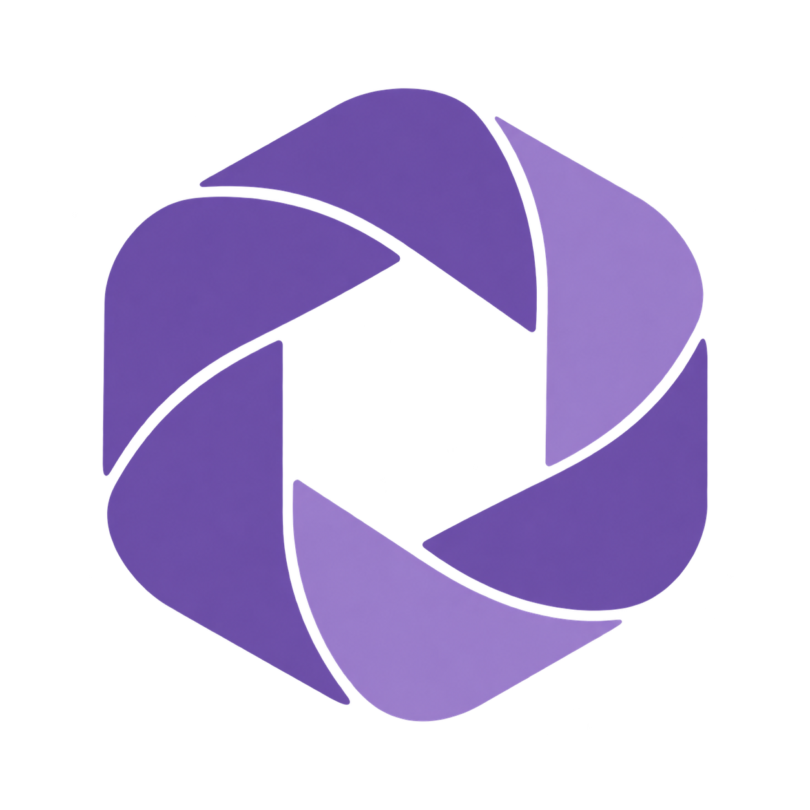
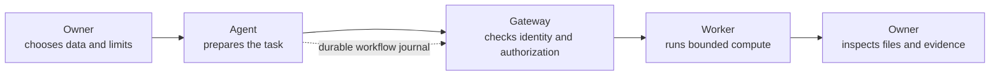

<p align="center">
  
</p>

<h1 align="center">Aperture</h1>

<p align="center">
  <strong>AI inference gateway and compute marketplace.<br>Owner-approved requests, one task flow.</strong>
  <br><br>
  Model providers, compute workers and recoverable workflows, with optional Solana Devnet settlement.
</p>

<p align="center">
  <a href="https://github.com/AliNurym/aperture-ai-gateway/actions/workflows/ci.yml"></a>
  <a href="LICENSE"></a>
</p>

**Aperture connects model providers and compute workers through one Solana-aware gateway.** Consumers choose a configured model or CPU route, approve a request-specific spending and runtime limit, then inspect the signed result. The same task path also supports delegated agents, Python workloads and recoverable data workflows.

The MVP directory combines authenticated Python workers with operator-configured model offers. The gateway checks signed task terms before dispatch; workers return signed execution evidence, and a journal lets accepted workflows recover after interruption. The updated contract source pins the assigned worker key and routes 100% of a confirmed Devnet task charge to that worker. This source change has not been redeployed or verified with a live payout; `OFF_CHAIN` execution makes no Solana payment. Discovery remains operator-configured, and external model API bills are paid outside Aperture.

## The control loop



The authorization binds a task to its source, immutable input hashes, parameters, budget, and runtime. The agent connects through the Python SDK or a local MCP server. The journal records accepted work so the host can recover it without blindly submitting duplicates.

## What Aperture does today

| Layer | Current capability |
| --- | --- |
| **Permission** | Wallet-linked agent identity and task-level quotes with explicit spend and runtime ceilings. |
| **Compute** | CPU-based Python jobs, including reviewed CSV batch and merge workflows. |
| **Worker choice** | Select a real worker in the network, bind its ID/key to the signed quote, and verify that the same executor produced the result. |
| **Providers** | Authenticated operator workspace with durable task/earning totals, private activity and drain/resume admissions that preserve running work. See [worker operations](docs/worker-market.md). |
| **Inference** | Streamed chat requests to operator-configured Gemini or OpenAI-compatible model servers, bound to signed task quotes and the separate `inference.chat` permission. Studio can send the exact Python source through the same path for an AI Sentinel review. |
| **Agent access** | Python SDK and local MCP tools for preparing, running, inspecting, and recovering work. The host supplies its own AI model. |
| **Recovery and results** | Durable workflow journals, named output files, signed receipts, and SHA-256 checks before download. |
| **Settlement** | Optional Solana Devnet payment channels; requires a compatible deployed program and a funded channel. |

The MVP is a React workspace, FastAPI gateway, Python and inference workers, SDK/MCP tools, and an optional Solana settlement path. Model access shares admission, limits, cancellation and signed receipts. Operators configure model offers; permissionless discovery and direct payments to upstream model vendors are not implemented. The source-level Devnet settlement path pays the assigned worker the full measured task charge, but still needs deployment and a verified live run.

Studio connects the original AI Sentinel idea to the current compute flow: the owner requests a signed model review of the current Python source, inspects its verified receipt beside that source, then opens the regular CPU quote. The gateway source policy makes the execution decision, followed by a separate owner signature. The model review and verifiable compute result now live in one task journey.

A matching completed Gemini review is attached to the compute manifest as `parameters.aperture_review`. The gateway checks its owner, exact source-review prompt and receipt hash before quoting; the owner's signature and final compute receipt cover the manifest digest. Changing the source, wallet or gateway prevents automatic reuse. The result view exposes the review reference and lets the owner download the task manifest. This records provenance; it does not turn a model verdict into execution permission.

## Evidence from the MVP

In a recorded local run, a five-task workflow processed **17,000 synthetic rows**, recovered after an intentional interruption, and completed without duplicate task admission. All three result files matched a direct Python run byte for byte.

That run used trusted host CPU execution in `OFF_CHAIN` mode. It is evidence of workflow recovery and output consistency—not Docker isolation, a Solana payment, remote-compute correctness, or a performance advantage. See the [reproduction steps and full limits](docs/mvp-evidence.md).

## Try it locally

On Windows, with Python 3.11+ and Node.js with npm:

```powershell
.\start_preview.bat
```

The launcher starts the unified console, gateway, and reviewed CPU worker
together, and adds the inference worker when Gemini is configured:

- Console: [http://127.0.0.1:3000](http://127.0.0.1:3000)
- API docs: [http://127.0.0.1:8000/docs](http://127.0.0.1:8000/docs)

Connect a wallet, open **Compute Studio**, then review and approve task limits. This performs real local CPU computation in `OFF_CHAIN` mode: no Solana payment and no Docker isolation. Without a Gemini key, model and AI Sentinel panels explain how to connect the route; Python compute remains available. A temporary development key exists only in browser memory; use a persistent wallet if you need approvals to survive a reload.

> **Protocol tour:** `start_demo.bat` opens the five-stage overview. Capacity and settlement indicators read live gateway state; the tour itself does not submit a task. Configure `backend/.env` as shown below before `start_preview.bat` to add the original Gemini review to the same Studio and gateway.

## Boundaries that matter

- **Local preview:** runs reviewed code on the host; it has no container security boundary.
- **Configured Docker worker:** applies container and resource limits. The coordinator remains trusted because it controls the Docker socket.
- **Devnet settlement:** needs a compatible deployed program, verified configuration, and a funded payment channel. The local preview does not deploy, fund, or settle anything.
- **Signed evidence:** ties identities, workload details, and file hashes to a receipt. It does not prove that a remote worker faithfully performed the computation.
- **Model inference:** the chosen provider receives the approved prompt. The current tariff bills elapsed time, including provider waiting; it is not token billing. The local adapter cannot guarantee upstream cancellation or answer correctness.

## Enable Gemini in the unified preview

To use the original Aperture Gemini model on Windows, create the ignored local
environment file and add your Google AI Studio key:

```powershell
Copy-Item backend/.env.example backend/.env
notepad backend/.env
.\start_preview.bat
```

Fill in `GEMINI_API_KEY` in `backend/.env`; the preview reads only the Gemini
settings from it and passes the key to the inference worker, not the browser or
gateway. The Gemini provider runs through the same signed Aperture task path as
Python compute; the preview is still `OFF_CHAIN` with no Solana payment. The older
`start_inference_preview.bat` entry point remains available for compatibility.
See
[Gemini setup and provider details](docs/inference.md#reconnect-the-original-gemini-model).

The normal product demo uses the remote Gemini API; it does not download model
weights. Open [Compute Studio](http://127.0.0.1:3000/#studio), choose
**Temporary key**, review the request and quote, then sign it. Run
`python scripts/inference_preview.py --check` with Gemini configured to verify
model inference, receipt recovery and the CPU path. See
[setup, API, SDK and billing boundaries](docs/inference.md).

## Documentation

| Start here | Guide |
| --- | --- |
| Run the product | [Local walkthrough and Devnet runbook](docs/demo-runbook.md) |
| Build workflows | [Agent jobs, approvals, and recovery](docs/agent-workflows.md) |
| Connect an agent | [Python SDK](docs/python-agent-sdk.md) · [MCP host](docs/mcp-agent.md) |
| Use model inference | [Gemini and other providers, permissions and receipts](docs/inference.md) |
| See how the old project fits | [Historical feature integration and remaining gaps](docs/historical-integration.md) |
| Understand settlement | [Solana protocol](docs/protocol-v2.md) |
| Check the claims | [MVP evidence and limits](docs/mvp-evidence.md) · [Pilot checklist](docs/pilot-checklist.md) |
| Product direction | [Architecture whitepaper](docs/WHITEPAPER.md) · [Two-minute pitch](docs/pitch-en/Aperture-Pitch-Script-EN-v5.md) · [Interactive deck](docs/presentation.html) |

## Development

The [CI workflow](.github/workflows/ci.yml) covers backend, SDK, frontend, and local-validator checks. After installing the backend requirements and SDK extra, run the local-only end-to-end check for the model adapter, worker, receipt recovery, agent limits, and CPU path:

```powershell
python scripts/check_inference_preview.py
```

It uses a fixed local SSE fixture, so it does not need an API key or contact an upstream model. Then run the frontend lint, build, and data tests locally:

```powershell
cd frontend
npm run lint
npm run build
npm run test:data
```

## License

[MIT](LICENSE)
