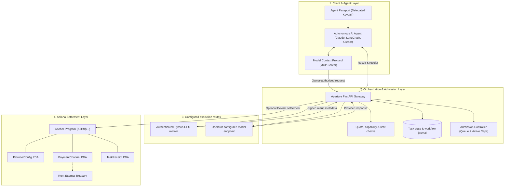
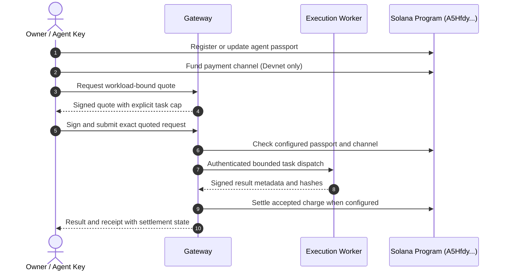

# Aperture: Solana AI Inference Gateway and Compute Marketplace

**Version:** MVP architecture brief · 22 October 2026
**Status:** Product scope and implementation notes
**Solana Program ID:** `A5HfdyRWy77i5DxhTMBa1ZinxVGZbVZnb35EvXUvkNzQ`

---

> **Current scope:** Aperture combines operator-configured OpenAI-compatible model offers, authenticated CPU workers, and recoverable data workflows behind one owner-controlled gateway. Local execution is `OFF_CHAIN` and does not make a Solana payment. Updated contract source pins the assigned worker and routes it 100% of a confirmed Devnet task charge; deployment and live payout evidence remain outstanding. The gateway does not pay upstream model API vendors directly, provide permissionless discovery or GPU capacity, or prove that a worker computed correctly. See [inference setup](inference.md), the [MVP evidence](mvp-evidence.md), and the [Devnet protocol](protocol-v2.md).

## 1. Abstract

AI agents can choose actions and call tools, but the owner still needs a way to bound each request, data job, and compute task. Aperture puts that decision into one task path: select a configured model offer or worker route, review a workload-bound quote, authorize its spending and runtime limits, then inspect the signed result metadata.

The MVP includes streamed model inference, CPU-based Python work, an SDK and MCP tools, and resumable data workflows. Model offers are configured by the gateway operator; Python workers authenticate to the gateway. Owner-signed policies and task quotes apply before dispatch. A durable journal supports recovery of accepted workflow steps. Solana Agent Passport and payment-channel accounts can record delegation and settlement on Devnet when the program and a funded channel are configured. Signatures and hashes make returned evidence checkable; they do not prove the provider or worker returned a correct answer.

---

## 2. The agent permission problem

```
┌────────────────────────────────────────────────────────────────────────┐
│                        THE COMPUTE DILEMMA                             │
├──────────────────────────────────┬─────────────────────────────────────┤
│      LOCAL HOST EXECUTION        │        CONFIGURED CLOUD ROUTES     │
├──────────────────────────────────┼─────────────────────────────────────┤
│ [-] Owner must trust local code   │ [-] Provider sees sent prompts     │
│ [-] Hard to bound agent actions   │ [-] Spend policy may span services │
│ [-] Results may lack provenance   │ [-] Recovery can be application-led│
│ [-] Manual approval adds friction │ [-] Usage terms vary by provider   │
└──────────────────────────────────┴──────────────────────────────────────┘
                                   │
                                   ▼
┌─────────────────────────────────────────────────────────────────────────┐
│              APERTURE: OWNER-AUTHORIZED TASK ROUTING                     │
├─────────────────────────────────────────────────────────────────────────┤
│ [+] Owner-issued agent policies and task spending ceilings               │
│ [+] Configured model offers and authenticated CPU worker routes           │
│ [+] Bounded admission, cancellation, and recoverable workflows           │
│ [+] Signed task evidence and checkable result hashes                     │
│ [+] Optional Solana Devnet delegation and payment-channel settlement     │
└─────────────────────────────────────────────────────────────────────────┘
```

The product is designed around three practical questions: which route receives the task, what permission and maximum spend authorize it, and what evidence returns afterward. Aperture provides controls and a record for that flow; it does not remove trust in the gateway, host, or configured model provider.

---

## 3. Protocol Architecture & System Layers

Aperture currently connects these components:



### 3.1 Owner permission and task quotes
An owner can register, update, or revoke a wallet-linked agent policy. Policies bind the owner, agent key, capabilities, per-task spending ceiling, runtime ceiling, expiry, and aggregate allowance. The gateway checks the applicable local or on-chain policy before accepting work. Browser workflow approvals apply to individual steps; SDK and MCP clients can operate on a previously assigned plan within its approved limits. This is wallet-issued compute permission, not legal identity verification or a certification of the agent.

### 3.2 Workload binding and routing
Each quote binds the workload, route or provider offer, inputs, limits, and authorized cost. Python source checks reject selected constructs but are not a sandbox. Reviewed CSV profiles use an operator-set tariff; custom Python quotes use a static heuristic and do not claim to predict real hardware performance. Inference quotes bind the configured offer and approved messages, use a maximum output size, and charge elapsed time under the configured rate rather than token usage. See the [inference guide](inference.md) for the exact API and limitations.

### 3.3 Execution and result evidence
Python jobs run on authenticated workers. A trusted-local worker executes on the host and has no container boundary. When configured, the Docker worker applies isolation and resource limits; its host and coordinator remain trusted. Inference is sent to the selected configured provider, which receives the approved prompt. Gateway and worker signatures bind task metadata and reported hashes to the receipt. Hash checks establish that a downloaded file matches the receipt; they do not establish that its contents are correct.

### 3.4 SDK and MCP access
Aperture provides a local **Model Context Protocol (MCP)** stdio server and a Python SDK. Their tools cover Python task quotes and execution, inference provider listing and requests, data staging and artifact retrieval, workflow execution and recovery, and owner-assigned work. The connected agent host supplies its own model; MCP connects that host to Aperture and is not itself an AI provider.

### 3.5 Owner-assigned workflows
The workflow inbox lets an owner assign a bounded plan to a specific agent. The owner reviews task steps and limits in the browser flow; SDK/MCP clients can run or resume a plan already assigned to them. Accepted work is journaled so a host process can recover task state without blindly admitting a duplicate. The owner can stop further admission and request cancellation of tracked active work.

### 3.6 Owner-scoped data and artifacts
The object store scopes files to owner/agent identities, verifies hashes, enforces quotas, and prevents release while data is in use. Stored bytes are not encrypted at rest by this feature; host and authorized worker access remain trust boundaries. Container workers mount input data read-only when configured.

---

## 4. Optional Solana delegation and settlement

In `DEVNET` mode, owner-signed agent passport updates and funded payment channels use the deployed Aperture program. The gateway checks task limits before dispatch; settlement records the accepted charge in a persistent task receipt. In `OFF_CHAIN` mode, the gateway and worker still execute and sign receipts, but no Solana payment occurs. Program setup, account layouts, transaction steps, and recovery behavior are documented in the [protocol guide](protocol-v2.md). A configured Devnet path does not establish mainnet readiness or computational correctness.



### 4.1 On-Chain State Accounts
The program stores `ProtocolConfig`, `AgentPassport`, `PaymentChannel`, and
`TaskReceipt` accounts. The passport records owner-issued capabilities and
allowances; the channel bounds task settlement; each receipt records a unique
task outcome and charged amount. See the protocol guide for the authoritative
PDA seeds, field layouts, instruction formats, and account constraints.

---

## 5. Product position

Aperture's current distinction is the joined developer flow: choose model or
CPU capacity, authorize a bounded task for an agent, recover accepted workflow
steps, and inspect signed result evidence. This is an early gateway with
operator-configured model routes and authenticated CPU workers, not an open
provider exchange. The hypothesis is that keeping approval, routing, recovery,
and settlement state together is useful to Solana AI developers. Independent
pilots must establish adoption and economics; no cost or speed advantage is
claimed. See the source-linked [competitive landscape](competitive-landscape.md).

---

## 6. Threat Model & Security Posture

### 6.1 Trust boundaries and controls
* **Threat 1: Malicious Code Execution (Host Escape)**
  * *Control:* Source-policy checks reject selected unsafe constructs; they are not a sandbox. Configured Docker workers add an unprivileged container, disabled container networking, a read-only root and resource limits. The trusted-local preview has no container boundary.
* **Threat 2: Exhaustion DoS & Fork Bombs**
  * *Control:* Docker process, memory, CPU and time limits depend on a correctly configured host and do not protect trusted-local execution. The gateway also caps active tasks.
* **Threat 3: Double-Claiming & Financial Replay**
  * *Control:* Unique task and receipt state constrain duplicate admission and settlement; recovery behavior is documented in the [MVP evidence](mvp-evidence.md) and [protocol guide](protocol-v2.md).
* **Threat 4: Worker Result Tampering**
  * *Control:* Worker and gateway signatures bind reported task metadata and result hashes. They do not prove faithful execution.
* **Threat 5: Prompt and data exposure**
  * *Control:* The selected model provider receives the approved prompt. Object-store data is not encrypted at rest by this feature; host, gateway, worker, and provider access remain trust boundaries.

---

## 7. Roadmap & Future Innovations

1. **Independent provider onboarding:** Publish provider offer and worker health policies, then test discovery, selection, and reliability with external operators.
2. **Settlement verification:** Deploy and verify the worker-payout path on Devnet, then measure real provider operations. Direct settlement to upstream model vendors needs separate accounting and contract design.
3. **Stronger execution evidence:** Evaluate independent re-execution, TEE attestations, or challenge mechanisms before claiming computation verification.
4. **GPU and production operation:** Add GPU capacity only after route selection, resource isolation, pricing, monitoring, and recovery are implemented and measured.

---

## 8. Conclusion

Aperture is an early AI inference and compute gateway for developers who need
owner-approved model requests and CPU workloads in one agent workflow. Its
Devnet protocol can record delegation and task settlement when configured;
signed evidence ties the reported result to a task but does not prove
correctness. Permissionless discovery and direct upstream-vendor settlement
remain product directions that require implementation and independent
validation.
